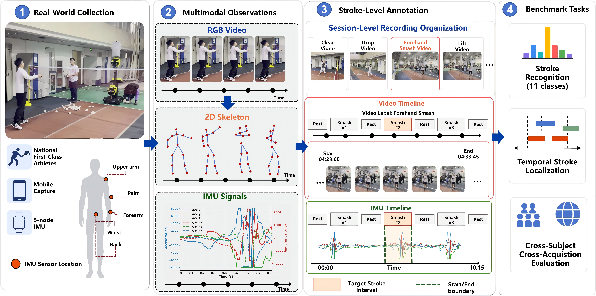

# BadmintonSkill-23

Official code release for **BadmintonSkill-23**: multimodal badminton stroke recognition and temporal action detection.

**Dataset download (gated):** [**https://huggingface.co/datasets/NaichuanZheng/BadmintonSkill-23**](https://huggingface.co/datasets/NaichuanZheng/BadmintonSkill-23)



| | |
|---|---|
| **Dataset** | [NaichuanZheng/BadmintonSkill-23 on Hugging Face](https://huggingface.co/datasets/NaichuanZheng/BadmintonSkill-23) |
| **Participants** | 23 anonymized IDs (`S001`–`S023`) |
| **Tasks** | 11-class stroke recognition · temporal action detection (TAD) |
| **Modalities** | RGB · 2D skeleton · 5-node IMU |
| **Ethics** | BSU committee approval **2026299H** (24 Jun 2026) |

## Repository layout

| Directory | Description |
|-----------|-------------|
| `imu_classification/` | IMU stroke recognition models and training |
| `rgb_classification/` | MMAction2 RGB baselines |
| `skeleton_classification/` | Skeleton HAR (ProtoGCN / BlockGCN / PySKL adapters) |
| `multimodal_fusion/` | Late fusion and CoM-M2U multimodal ensemble |
| `tad_opentad/` | OpenTAD-based temporal action detection |
| `benchmark_examples/` | Loaders, metrics, and minimal runnable examples |
| `scripts/` | Score export helpers |
| `path_adapter.py` | Dataset path helper |

## Dataset

All multimodal data (skeleton, IMU, annotations, and gated RGB video) are hosted on Hugging Face:

**https://huggingface.co/datasets/NaichuanZheng/BadmintonSkill-23**

Request access on the dataset page. After approval, download the archives listed below. Ethics documents and license terms are in the repo under `documents/`.

## Quick start

### 1. Get the dataset

Open [**NaichuanZheng/BadmintonSkill-23**](https://huggingface.co/datasets/NaichuanZheng/BadmintonSkill-23) and request access.

Download and extract:

- `Skeleton.tar.gz`, `IMU.tar.gz`
- `Annotations_Splits_Metadata.tar.gz`, `RecordingAnnotations.tar.gz`
- `RGB_S001.tar` … `RGB_S023.tar` (restricted RGB — DUA required)

Archive paths use `{Sxxx}/{Sxxx_MMDD}/{modality}/...` (ASCII only).

### 2. Point code at the data

```bash
export BADMINTONSKILL23_ROOT=/path/to/extracted/dataset
```

Or edit paths in configs under each module.

### 3. Run benchmark examples

```bash
pip install numpy pandas opencv-python

python benchmark_examples/dataloader_examples/run_all_loaders.py
python benchmark_examples/classification_evaluation.py
python benchmark_examples/tad_evaluation.py
```

See `benchmark_examples/benchmark_readme.md` for details.

## Training dependencies

Full reproduction requires external frameworks (not bundled in full):

- **RGB:** MMAction2
- **Skeleton:** PySKL / ProtoGCN / BlockGCN (slim vendor trees included)
- **TAD:** OpenTAD (source included under `tad_opentad/`)

Pretrained weights are distributed separately on the dataset hub (`weights_*.tar`).

## License

- **Code in this repository:** MIT (see `LICENSE`) unless a subdirectory carries its own upstream license (OpenTAD, MMAction2 adapters, etc.).
- **Dataset:** research-only, non-commercial — see [`documents/03_dataset_license.txt`](https://huggingface.co/datasets/NaichuanZheng/BadmintonSkill-23/tree/main/documents) on Hugging Face.

## Citation

```bibtex
@inproceedings{badmintonskill23,
  title   = {BadmintonSkill-23: ...},
  author  = {...},
  booktitle = {WACV},
  year    = {2027}
}
```

*(Update with camera-ready bibliographic data.)*
